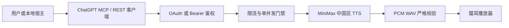

# Auralis Voice

> A self-hosted MiniMax China TTS bridge for local apps and ChatGPT, with a
> secure API, OAuth-protected MCP integration, and an animated cat-ear player.

Auralis Voice 是一套可自行部署的轻量语音系统。它把 MiniMax 中国区 TTS、
服务端安全门禁、ChatGPT 私有 MCP 接入和猫耳播放界面整理成一个通用仓库。

每位部署者使用自己的 MiniMax API Key、`voice_id`、模型和访问令牌。仓库不提供
共享付费实例，也不包含真实密钥、私人音色、私人域名或私人项目资产。

## 特性

- 固定调用 MiniMax 中国区 `t2a_v2`，输出并严格校验 16 kHz 单声道 PCM WAV。
- 提供两条接入线路：Bearer 保护的 REST API，以及 OAuth 保护的 ChatGPT MCP。
- 在鉴权、限流或并发门禁失败时，不调用上游 provider。
- 猫耳播放器包含 `idle`、`loading`、`playing`、`paused`、`ended` 五态。
- MCP 气泡只有在 WAV 结构和时长通过校验后才允许播放；失败不会伪装成可播放。
- 单实例默认限制为 6 次/60 秒、同时最多 1 项真实合成。
- 默认只监听 `127.0.0.1`；非 loopback 启动时强制要求访问令牌。
- 保留本地 TTS provider 的 adapter 扩展位；V1 已实现的生成引擎仍只有 MiniMax。

## 系统线路



更完整的请求、音频和播放状态线路见
[`docs/ARCHITECTURE.md`](docs/ARCHITECTURE.md)。

## 接口与生成引擎

“本地接口”和“本地生成引擎”是两件不同的事：

| 能力 | 当前状态 | 说明 |
| --- | --- | --- |
| 本地应用接口 | 已实现 | 桌面应用或自建前端通过 `POST /api/tts` 调用 Auralis |
| ChatGPT 接口 | 已实现 | ChatGPT 通过 OAuth MCP 调用同一套服务端门禁 |
| MiniMax 生成引擎 | 已实现 | V1 默认且唯一启用的真实 TTS provider |
| 本地 TTS 引擎 | 仅保留扩展位 | 可按 adapter 契约接入；Breeze 占位当前明确返回 `501` |

因此，通用版不会删除本地扩展能力，也不会把尚未实现的本地 TTS 宣传成可用功能。
新增 provider 时必须继续经过同一套 WAV 校验、安全门禁和错误脱敏，不得绕过现有契约。

## 猫耳动态设计

猫耳不是贴在普通进度条上的装饰，而是播放器状态本身的一部分。耳朵、耳芯、外壳和
声波使用同一套几何与配色关系，并随真实音频事件切换：

| 状态 | 动态表现 |
| --- | --- |
| `idle` | 双耳与外壳自然衔接，保持安静待命 |
| `loading` | 左右耳错峰轻轻竖起，声波呼吸，生成图标旋转 |
| `playing` | 双耳以不同相位小幅回应，18 根声波依次起伏 |
| `paused` | 双耳压低，声波冻结并淡下去 |
| `ended` | 双耳缓慢收落，声波收平，按钮切换为重新播放 |

五态由真实音频事件驱动，不用计时器假装播放。MCP 气泡在音频未验证完成时按钮不可
点击；播放、暂停和播完不会改变气泡外层高度。系统开启“减少动态效果”时，动画会
自动收敛。

## 当前状态

- 公开基线：`0.1.0`
- 离线测试：`77/77` 通过
- JavaScript 语法检查与视觉哈希锁：通过
- REST、OAuth MCP、MiniMax 中国区真实生成和 ChatGPT 猫耳气泡播放：已验收
- 播放键仅在音频就绪后可用；播放时布局保持稳定

当前限制：OAuth 授权码、访问令牌和刷新令牌只保存在单个服务进程内存中。
服务重新部署或重启后，ChatGPT 连接需要重新授权。需要多实例或无感重启时，
应先替换为受保护的持久化令牌存储。

## 快速开始

环境要求：Node.js 20 或更高版本，以及部署者自己的 MiniMax 中国区配置。

```text
npm install
npm test
```

复制 `.env.example` 为 `.env`，至少填写：

```dotenv
MINIMAX_API_KEY=
MINIMAX_GROUP_ID=
MINIMAX_VOICE_ID=
MINIMAX_MODEL=
```

`MINIMAX_GROUP_ID` 在新版平台通常留空；旧账号只有在平台明确提供时才填写。

本地启动：

```text
node --env-file=.env src/server.js
```

默认地址：

- 健康检查：`http://127.0.0.1:3000/health`
- 播放器预览：`http://127.0.0.1:3000/player/preview.html`
- 受控 smoke：`http://127.0.0.1:3000/player/smoke.html`

`smoke.html` 只用于部署者进行单次真实验收，不是产品入口。不要提交、上传或
公开 `.env`。

## 选择接入方式

| 方式 | 入口 | 适用场景 | 鉴权 |
| --- | --- | --- | --- |
| REST | `POST /api/tts` | 本地应用、桌面宿主、自建前端 | Bearer token |
| ChatGPT MCP | `/mcp` | ChatGPT 私有插件与猫耳气泡 | OAuth 2.0 + PKCE |
| 视觉预览 | `/player/preview.html` | 不调用 TTS 的五态检查 | 无 |

REST 的请求、错误码和播放器方法见
[`docs/PLAYER-CONTRACT.md`](docs/PLAYER-CONTRACT.md)。部署与 ChatGPT 连接步骤见
[`docs/DEPLOYMENT.md`](docs/DEPLOYMENT.md)。

## 服务端配置

| 环境变量 | 是否必填 | 用途 |
| --- | --- | --- |
| `MINIMAX_API_KEY` | 是 | 部署者自己的 MiniMax 中国区 API Key |
| `MINIMAX_GROUP_ID` | 否 | 新版平台通常留空；旧账号按平台提供值填写 |
| `MINIMAX_VOICE_ID` | 是 | 部署者自己的音色 ID |
| `MINIMAX_MODEL` | 是 | MiniMax 模型名称 |
| `PUBLIC_V1_ACCESS_TOKEN` | 生产必填 | 非 loopback 时至少 32 字符且不含空白 |
| `AURALIS_PUBLIC_ORIGIN` | 启用 MCP 时必填 | 部署服务的精确 HTTPS origin |
| `AURALIS_OAUTH_CLIENT_ID` | 启用 MCP 时必填 | OAuth 客户端标识，8 至 128 个无空白字符 |
| `AURALIS_OAUTH_CLIENT_SECRET` | 启用 MCP 时必填 | 至少 32 字符的服务端密钥 |
| `AURALIS_OAUTH_REDIRECT_URI` | 启用 MCP 时建议填写 | ChatGPT 显示的精确 Callback URL |
| `HOST` | 否 | 默认 `127.0.0.1`；云部署通常设为 `0.0.0.0` |
| `PORT` | 否 | 默认 `3000`；云平台使用其注入值 |

API Key、GroupId、`voice_id`、模型和上游端点只来自服务端环境，客户端不能覆盖。

## 安全边界

- loopback 本地开发可以不配置 `PUBLIC_V1_ACCESS_TOKEN`。
- 非 loopback 部署缺少合格令牌时，服务拒绝启动。
- `POST /api/tts` 只接受 `{ "text": "..." }`，未知字段会被拒绝。
- 静态文件使用固定白名单；`.env`、源码和目录列表不会被服务端公开。
- 错误响应不会包含密钥、令牌、GroupId、`voice_id`、堆栈或上游完整响应。
- 共享浏览器令牌不是多用户账号系统。本 V1 适合个人自用或小范围受控接入。

若要向不受信任的陌生用户开放，必须另行设计正式身份、持久化配额、计费保护和
审计，不应直接复用本 V1 的共享令牌模型。

## 项目结构

```text
src/                    HTTP、OAuth、MCP、安全门禁与 provider adapters
public/player/          锁定的猫耳播放器、视觉母版与预览页
test/                   离线回归、安全负例、MCP 与视觉锁测试
test-support/           测试用 WAV 构造工具
docs/ARCHITECTURE.md    两条接入线路与状态不变量
docs/DEPLOYMENT.md      本地、Render 与 ChatGPT MCP 部署步骤
docs/PLAYER-CONTRACT.md REST 与播放器稳定契约
STATUS.md               当前验收事实与已知限制
```

`player.config.json` 只是颜色示例，不会被组件自动读取。运行时颜色通过元素属性设置：

```html
<cat-ear-player color="#D8CEF2"></cat-ear-player>
```

## 文档

- [架构与调用线路](docs/ARCHITECTURE.md)
- [部署与 ChatGPT 连接](docs/DEPLOYMENT.md)
- [播放器与 REST 契约](docs/PLAYER-CONTRACT.md)
- [当前状态](STATUS.md)
- [版本记录](CHANGELOG.md)

## 范围外功能

V1 不包含账号、收藏、声音馆、长期记忆、Dashboard、多用户后台、完整主题系统。
Breeze 等本地 TTS 只保留 adapter 扩展位，不属于当前已实现功能。

## License

本项目使用 [MIT License](LICENSE)。部署者仍须自行遵守 MiniMax 等第三方服务的
条款，并保护自己的密钥、音色、访问令牌与使用额度。
