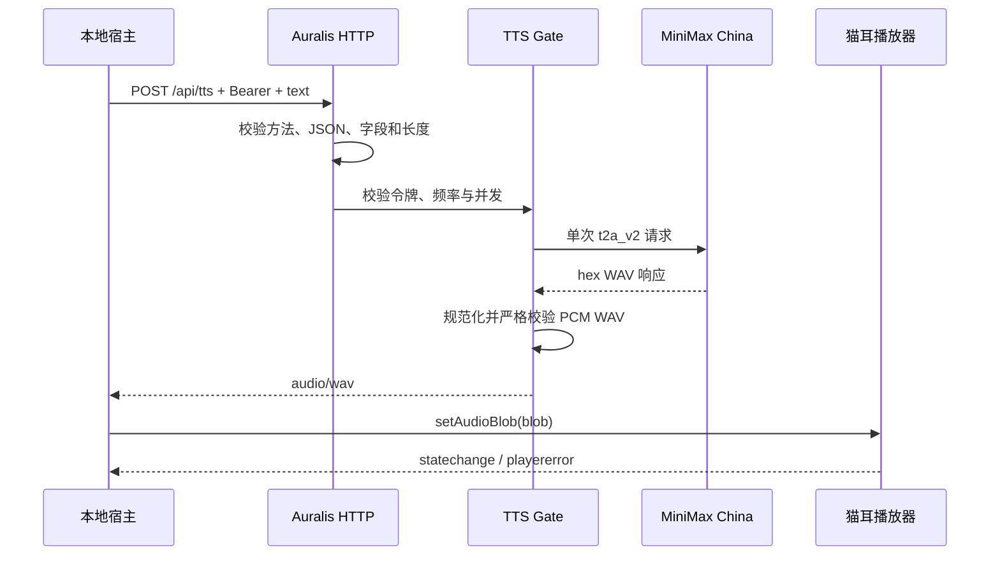
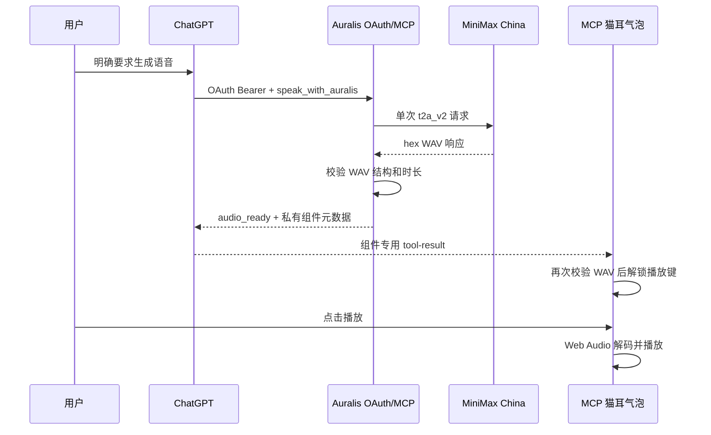
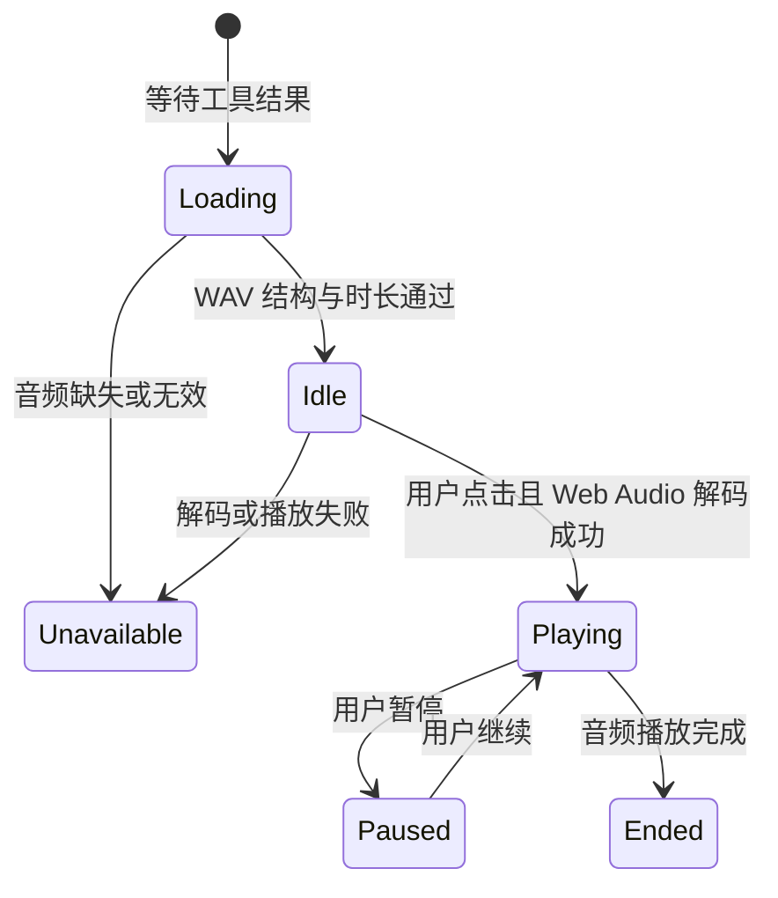

# 架构与调用线路

本文描述 Auralis Voice V1 的真实运行线路、信任边界和播放就绪条件。代码与本文
不一致时，以测试覆盖的代码行为为准。

## 组件

| 组件 | 职责 | 不负责 |
| --- | --- | --- |
| `src/server.js` | HTTP 路由、静态白名单、REST 请求验证 | 保存用户账号或音频 |
| `src/tts-gate.js` | Bearer 校验、6 次/60 秒限流、单并发 | 分布式配额 |
| `src/adapters/minimax.js` | 调用 MiniMax 中国区并规范化响应 | 接受客户端覆盖模型参数 |
| `src/wav.js` | 校验 16 kHz、单声道、PCM16 WAV | 转码任意音频格式 |
| `src/oauth.js` | OAuth 发现、PKCE、授权码与令牌 | 持久化令牌存储 |
| `src/mcp.js` | MCP 工具、私有音频元数据、ChatGPT 气泡宿主 | 把音频写进普通模型文本 |
| `cat-ear-player.js` | 锁定视觉、五态与基础播放控制 | 服务端鉴权与计费保护 |

## REST 线路

只要鉴权、限流、并发或输入校验失败，MiniMax 就不会收到请求。

## ChatGPT MCP 线路

音频 Base64 只位于组件专用元数据中，不进入普通文本内容。工具发现、OAuth 授权、
健康检查和静态页面访问都不会自动触发真实 TTS。

## 播放就绪不变量

- 音频未通过结构校验时，按钮保持禁用。
- `00:00` 不能作为“音频已就绪”的证明；就绪时必须显示校验得到的真实时长。
- Web Audio 解码和 `source.start()` 均发生在用户点击手势内。
- 播放失败会禁用按钮并显示错误，不会自动重试或再产生一次付费请求。
- 播放状态切换不插入瞬时布局占位，因此气泡不会因点击发生上下跳动。

## 信任边界

1. MiniMax 密钥、GroupId、`voice_id` 和模型只存在于服务端环境。
2. REST Bearer token 不得写进公开前端；由受控宿主在当前会话提供。
3. MCP OAuth client secret 只存在于服务端和 ChatGPT 私有连接配置。
4. OAuth access/refresh token 当前只保存在单进程内存中，部署重启后失效。
5. 限流也是单实例内存状态，不适合多实例或面向陌生用户的公共服务。

## 固定路由

| 路由 | 方法 | 用途 |
| --- | --- | --- |
| `/health` | GET | 无副作用健康检查 |
| `/api/tts` | POST | Bearer 保护的 WAV 合成 |
| `/mcp` | POST/GET/DELETE | OAuth 保护的 MCP transport |
| `/.well-known/*` | GET | OAuth / MCP 发现 |
| `/oauth/authorize` | GET | PKCE 授权码入口 |
| `/oauth/token` | POST | 授权码或刷新令牌交换 |
| `/player/preview.html` | GET | 离线五态预览 |
| `/player/smoke.html` | GET | 部署者单次真实验收 |

除固定静态白名单外，项目文件、目录列表、`.env` 和源码均不通过 HTTP 服务公开。
